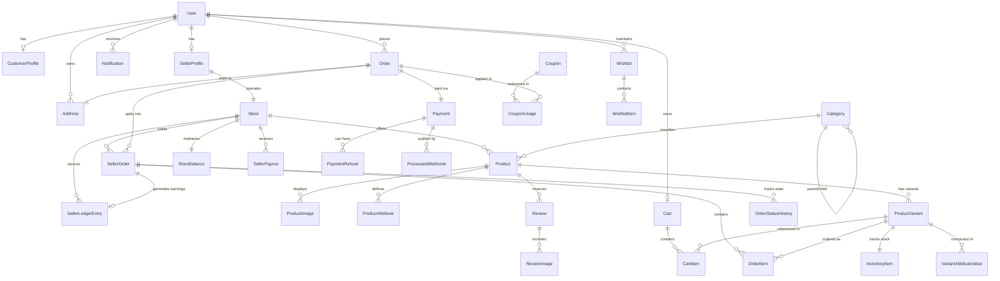

# KIVORA — SYSTEM ARCHITECTURE & ENGINEERING SPECIFICATION

> **Document Version:** 1.1.0  
> **Status:** Production-Ready Architecture Blueprint (Refined)  
> **Target Release:** Kivora Multi-Vendor Marketplace  
> **Author:** Senior Full-Stack Software Architect & Technical Lead  
> **Date:** November 2026

---

## 1. EXECUTIVE SUMMARY & SYSTEM OVERVIEW

**Kivora** is an enterprise-grade, multi-vendor e-commerce platform engineered for scale, high reliability, data consistency, and exceptional user experience across mobile and web surfaces.

The platform unifies three distinct user personas into a cohesive ecosystem powered by a centralized backend engine:

```
                                  ┌────────────────────────┐
                                  │   KIVORA ECOSYSTEM     │
                                  └───────────┬────────────┘
                                              │
           ┌──────────────────────────────────┼──────────────────────────────────┐
           │                                  │                                  │
           ▼                                  ▼                                  ▼
┌───────────────────────┐          ┌───────────────────────┐          ┌───────────────────────┐
│ Customer Mobile App   │          │ Seller Web Dashboard  │          │ Admin Web Dashboard   │
│ (React Native / Expo) │          │ (Next.js 14+ App Router│         │ (Next.js 14+ App Router│
│ iOS & Android         │          │ Tailwind CSS)         │          │ Tailwind CSS)         │
└──────────┬────────────┘          └──────────┬────────────┘          └──────────┬────────────┘
           │                                  │                                  │
           │ REST API / WebSocket             │ REST API / WebSocket             │ REST API / WebSocket
           └──────────────────────────────────┼──────────────────────────────────┘
                                              │
                                              ▼
                                 ┌─────────────────────────┐
                                 │   Kivora Central API    │
                                 │  (Node.js / Express TS) │
                                 └────────────┬────────────┘
                                              │
               ┌──────────────────────────────┼──────────────────────────────┐
               ▼                              ▼                              ▼
    ┌────────────────────┐         ┌────────────────────┐         ┌────────────────────┐
    │  PostgreSQL (ACID) │         │ Redis (Cache & Pub)│         │ External Services  │
    │  Prisma ORM Engine │         │ Socket.IO Adapter  │         │ Razorpay, Cloudinary│
    └────────────────────┘         └────────────────────┘         └────────────────────┘
```

### Core Architectural Pillars

1. **Multi-Vendor Partitioning:** Isolation of seller catalog, orders, metrics, and payouts while providing a seamless unified cart experience to the customer.
2. **Order Splitting Engine:** Automatic decomposition of multi-vendor shopping carts into independent seller sub-orders with granular tracking and fulfillment.
3. **Double-Entry Financial Accounting & Ledger:** Uncompromising payment reconciliation, escrow collection, platform commission deduction, and non-automatic batch seller disbursements.
4. **Resilient Two-Tier Inventory Concurrency:** Prevention of overselling via atomic Redis reservations (with TTL and recovery workers) backed by PostgreSQL transactional conditional decrements as the single source of truth.
5. **Contract-Driven Backend-First Engineering:** Establishing database schema, OpenAPI contracts, and shared Zod validation schemas prior to client interface construction.

---

## 2. BRAND IDENTITY & DESIGN SYSTEM SPECIFICATION

The Kivora design language embodies warmth, refinement, premium craftsmanship, and modern digital commerce ergonomics.

### 2.1 Color Palette & Accessibility Matrix

| Token Name          | Hex Code  | RGB                  | Role & Usage                                                           | WCAG AA/AAA Compliance Rules                             |
| :------------------ | :-------- | :------------------- | :--------------------------------------------------------------------- | :------------------------------------------------------- |
| **Primary Brown**   | `#3B2418` | `rgb(59, 36, 24)`    | Primary branding, headers, body text, primary actions, dark surfaces   | Contrast on Cream: **12.2:1** (Passes AAA)               |
| **Cream**           | `#F2E8DA` | `rgb(242, 232, 218)` | Dominant background, card containers, page canvases, light borders     | Contrast with Brown text: **12.2:1** (Passes AAA)        |
| **Baby Blue**       | `#8EC5FF` | `rgb(142, 197, 255)` | Interactive accent, primary button fills, pill highlights, badge tints | Pair with Brown (`#3B2418`) text: **8.5:1** (Passes AAA) |
| **Brown Light**     | `#5C3A27` | `rgb(92, 58, 39)`    | Secondary headings, hover states, active borders                       | Contrast on Cream: **7.8:1** (Passes AAA)                |
| **Sand Dark**       | `#E5D3BD` | `rgb(229, 211, 189)` | Card divider lines, input borders, disabled elements                   | Contrast with Brown: **9.8:1** (Passes AAA)              |
| **Success Emerald** | `#1B7A43` | `rgb(27, 122, 67)`   | Order delivered, active badges, payment success                        | Contrast on Cream: **5.6:1** (Passes AA)                 |
| **Warning Amber**   | `#C26700` | `rgb(194, 103, 0)`   | Low stock, order processing, pending payout                            | Contrast on Cream: **4.6:1** (Passes AA)                 |
| **Danger Crimson**  | `#BA1A1A` | `rgb(186, 26, 26)`   | Errors, order cancellation, refunds, stock depletion                   | Contrast on Cream: **6.1:1** (Passes AAA)                |

> [!IMPORTANT]
> **Accessibility Rule for Baby Blue (`#8EC5FF`):**  
> Baby Blue has high luminance (~0.55). **Never place white or light cream text on a Baby Blue background.** Any button or badge filled with `#8EC5FF` must use **Primary Brown (`#3B2418`)** for label text and iconography. This delivers an **8.5:1 contrast ratio**, well exceeding the WCAG AAA requirement.

### 2.2 Typography

- **Primary Typeface:** `Baloo Bhai 2` (Google Font)
- **Weights:**
  - Regular (400) — Descriptive body text, metadata, tooltips
  - Medium (500) — Navigation items, secondary button labels, form labels
  - SemiBold (600) — Card titles, section headers, badges
  - Bold (700) — Screen titles, hero typography, primary CTAs
  - ExtraBold (800) — Pricing displays, promotional headlines

---

## 3. MONOREPO ARCHITECTURE & TOOLING

We utilize **pnpm workspaces** orchestrated by **Turborepo** for high-efficiency monorepo management.

```
kivora/
├── apps/
│   ├── backend/          # Node.js + Express API
│   ├── mobile/           # React Native Expo app
│   ├── seller-web/       # Next.js Seller dashboard
│   └── admin-web/        # Next.js Marketplace Admin dashboard
├── packages/
│   ├── config/           # Shared ESLint, TS, Prettier, Tailwind
│   ├── types/            # Shared TypeScript contracts & DTOs
│   ├── validation/       # Shared Zod validation schemas
│   └── ui/               # Shared design tokens & UI components
├── docs/
│   ├── architecture/     # Architectural blueprints
│   └── api/              # OpenAPI specs & contract docs
├── package.json          # Root workspace definition
├── pnpm-workspace.yaml   # Workspace glob config
├── turbo.json            # Turborepo task pipeline & cache rules
└── tsconfig.base.json    # Base compiler options
```

---

## 4. DETAILED FOLDER STRUCTURE FOR ALL APPLICATIONS

### 4.1 Backend (`apps/backend`)

```
apps/backend/
├── prisma/
│   ├── schema.prisma              # Database schema definitions
│   ├── migrations/                # Version-controlled SQL migrations
│   └── seed.ts                    # Marketplace seed data (Admin, Categories, Sample Store)
├── src/
│   ├── config/
│   │   ├── env.ts                 # Validated environment variables (Zod)
│   │   ├── database.ts            # Prisma client instance & hooks
│   │   ├── redis.ts               # Redis cache & pub/sub connection
│   │   ├── cloudinary.ts          # Cloudinary client
│   │   └── razorpay.ts            # Razorpay client
│   ├── constants/
│   │   ├── error-codes.ts         # Standard error definitions
│   │   └── http-status.ts         # Numeric status constants
│   ├── modules/
│   │   ├── auth/                  # Register, Login, Token Refresh, Role guards
│   │   ├── user/                  # Customer profile, addresses, settings
│   │   ├── store/                 # Seller store registration, profile, settings
│   │   ├── category/              # Hierarchical categories & taxonomy
│   │   ├── product/               # Product catalog, variants, images, search
│   │   ├── inventory/             # Stock reservation engine & reconciliation
│   │   ├── cart/                  # Multi-vendor cart management
│   │   ├── order/                 # Order splitting, fulfillment, state machine
│   │   ├── payment/               # Razorpay orders, webhooks, signature verification
│   │   ├── payout/                # Seller ledger, commission, batch payout
│   │   ├── review/                # Product reviews, seller feedback, ratings
│   │   ├── coupon/                # Discounts, store coupons, platform promotions
│   │   ├── notification/          # In-app, push (Expo), email triggers
│   │   └── admin/                 # KYC approval, platform metrics, dispute resolution
│   ├── jobs/
│   │   ├── inventory-reconciler.ts# Background job clearing expired reservations
│   │   ├── payout-eligibility.ts  # Background job unlocking funds post-return window
│   │   └── webhook-retry-worker.ts# Dead-letter queue & retry worker for webhooks
│   ├── middleware/
│   │   ├── error-handler.ts       # Global error catching & standardized response
│   │   ├── rate-limiter.ts        # Redis-backed rate limiting per IP/User
│   │   ├── validate.ts            # Zod schema validation middleware
│   │   ├── authenticate.ts        # JWT verification & claims decoding
│   │   ├── authorize.ts           # Role-based access control (RBAC)
│   │   └── store-owner.ts         # Ownership guard for seller endpoints
│   ├── websocket/
│   │   ├── socket-server.ts       # Socket.IO initialization with Redis adapter
│   │   ├── socket-auth.ts         # Socket connection handshake JWT verification
│   │   └── event-handlers/        # Real-time order status, chat, notifications
│   ├── utils/
│   │   ├── api-response.ts        # Uniform response formatter
│   │   ├── password.ts            # Argon2 / Bcrypt hashing helpers
│   │   ├── token.ts               # JWT generator & verifier
│   │   └── logger.ts              # Winston structured logger
│   ├── app.ts                     # Express application builder
│   └── server.ts                  # HTTP & WebSocket server entrypoint
├── Dockerfile
├── tsconfig.json
└── package.json
```

---

## 5. REFINED DATABASE SCHEMA & ENTITY RELATIONSHIPS

The database is built on **PostgreSQL** using **Prisma ORM**, strictly adhering to 3NF principles with ACID-compliant relational integrity.



---

## 6. INVENTORY RESERVATION LIFECYCLE & CONCURRENCY SPECIFICATION

### 6.1 Complete Lifecycle State Machine

Inventory flows through five deterministic states:

```
                  ┌──────────────────────┐
                  │      AVAILABLE       │
                  └──────────┬───────────┘
                             │
            Customer initiates checkout intent
            (Atomic Redis DECRBY + Postgres lock)
                             │
                             ▼
                  ┌──────────────────────┐
                  │       RESERVED       │ ◄────────┐
                  └──────────┬───────────┘          │
                             │                      │
           ┌─────────────────┴─────────────────┐    │
           │                                   │    │
Payment captured                  Payment failed /  │
(Authoritative Webhook)           15m TTL expired   │
           │                                   │    │
           ▼                                   ▼    │
┌──────────────────────┐            ┌──────────────────────┐
│      COMMITTED       │            │       RELEASED       │
└──────────┬───────────┘            └──────────────────────┘
           │
  Customer returns / Seller cancels sub-order
           │
           ▼
┌──────────────────────┐
│      RESTOCKED       │ ───────────────────────────┘
└──────────────────────┘
```

| State         | Description                                                                        | Location of Truth                                                          |
| :------------ | :--------------------------------------------------------------------------------- | :------------------------------------------------------------------------- |
| **AVAILABLE** | Variant physical stock available for purchase.                                     | `InventoryItem.quantity - InventoryItem.reservedQuantity`                  |
| **RESERVED**  | Temporarily locked during checkout (15-minute TTL).                                | Redis key `reservation:{reservationId}` & `InventoryItem.reservedQuantity` |
| **COMMITTED** | Permanently sold and decremented following payment capture.                        | `InventoryItem.quantity` reduced in PostgreSQL                             |
| **RELEASED**  | Restored to available pool due to payment failure, cart abandonment, or timeout.   | Redis key deleted; `reservedQuantity` decremented in PostgreSQL            |
| **RESTOCKED** | Restored following an approved sub-order cancellation or verified customer return. | `InventoryItem.quantity` incremented in PostgreSQL                         |

### 6.2 Redis Fast-Locking Architecture

During checkout intent creation (`POST /api/v1/orders/checkout`), Kivora executes an atomic Redis Lua script:

```lua
-- KEYS[1]: stock_key (e.g. "inventory:variant:123:available")
-- ARGV[1]: requested_quantity
-- ARGV[2]: reservation_key (e.g. "reservation:res_789")
-- ARGV[3]: ttl_seconds (e.g. 900)

local current_stock = tonumber(redis.call('get', KEYS[1]) or 0)
local requested = tonumber(ARGV[1])

if current_stock >= requested then
    redis.call('decrby', KEYS[1], requested)
    redis.call('setex', ARGV[2], ARGV[3], requested)
    return 1 -- Success
else
    return 0 -- Insufficient stock
end
```

### 6.3 PostgreSQL Atomic Conditional Stock Update (Final Source of Truth)

While Redis absorbs peak flash-sale concurrency, **PostgreSQL is the ultimate authoritative source of correctness**.

When the authoritative payment webhook arrives, stock deduction is committed within an ACID database transaction:

```sql
UPDATE "InventoryItem"
SET "quantity" = "quantity" - $1,
    "reservedQuantity" = GREATEST(0, "reservedQuantity" - $1),
    "updatedAt" = NOW()
WHERE "variantId" = $2 AND "quantity" >= $1;
```

**Zero-Oversell Guarantee:**  
If two transactions concurrently pass Redis and reach PostgreSQL, the database row-level lock on `InventoryItem` evaluates the conditional clause `AND "quantity" >= $1`. If the row count affected is `0`, the transaction rolls back, marks the sub-order as `OUT_OF_STOCK`, releases any remaining locks, and automatically triggers an immediate full refund to the customer.

### 6.4 Expiration Recovery & Desync Reconciliation

1. **Redis Key Expiry:** Every reservation key has a 900-second (15-minute) TTL.
2. **Reconciliation Cron Worker (`jobs/inventory-reconciler.ts`):** Runs every 5 minutes:
   - Queries PostgreSQL for all `Order` records in `PENDING_PAYMENT` created more than 15 minutes ago.
   - For each expired order: marks status as `EXPIRED`, decrements `InventoryItem.reservedQuantity` in PostgreSQL, and re-syncs the Redis cache counter with `(quantity - reservedQuantity)`.
   - Ensures that network partitions or unexpected node crashes never leave orphaned reservations.

---

## 7. PAYMENT MANAGEMENT, WEBHOOK IDEMPOTENCY & RECONCILIATION

### 7.1 Payment State Machine

```
[CREATED] ──► [PENDING] ──► [CAPTURED] ──► [PARTIALLY_REFUNDED]
                 │              │                   │
                 ▼              ▼                   ▼
              [FAILED]      [REFUNDED]          [REFUNDED]
```

- **CREATED:** Razorpay Order initialized via backend API with exact server-calculated amount in paise.
- **PENDING:** Customer has opened checkout and submitted payment details; waiting for gateway settlement.
- **CAPTURED:** Payment captured and verified via authoritative webhook HMAC-SHA256 signature.
- **FAILED:** Payment declined by issuer, authentication timed out, or user dismissed gateway.
- **PARTIALLY_REFUNDED:** One or more seller sub-orders cancelled/returned; partial funds refunded to customer.
- **REFUNDED:** All sub-orders cancelled or returned; 100% of order amount returned to original payment source.

### 7.2 Webhook Idempotency & Signature Verification

Razorpay guarantees at-least-once delivery; webhooks may be delivered multiple times or out of order.

```typescript
// apps/backend/src/modules/payment/payment.webhook.ts
export async function handleRazorpayWebhook(req: Request, res: Response) {
  const signature = req.headers['x-razorpay-signature'] as string;
  const rawBody = (req as any).rawBody; // Preserved raw buffer

  // 1. Authoritative Signature Verification
  const expectedSignature = crypto
    .createHmac('sha256', process.env.RAZORPAY_WEBHOOK_SECRET!)
    .update(rawBody)
    .digest('hex');

  if (signature !== expectedSignature) {
    logger.warn('Tampered webhook signature received');
    return res.status(400).json({ error: 'Invalid signature' });
  }

  const event = req.body;
  const eventId = event.event_id || (req.headers['x-razorpay-event-id'] as string);

  // 2. Database Idempotency Check
  const existingEvent = await prisma.processedWebhook.findUnique({
    where: { eventId },
  });

  if (existingEvent) {
    logger.info(`Webhook event ${eventId} already processed. Returning 200 OK.`);
    return res.status(200).json({ status: 'ALREADY_PROCESSED' });
  }

  // 3. Record Pending Processing
  await prisma.processedWebhook.create({
    data: { eventId, eventType: event.event, status: 'PROCESSING' },
  });

  try {
    // 4. Execute Business Logic in Transaction
    await paymentService.processCapturedPayment(event.payload.payment.entity);

    // 5. Mark Completed
    await prisma.processedWebhook.update({
      where: { eventId },
      data: { status: 'COMPLETED' },
    });

    return res.status(200).json({ status: 'SUCCESS' });
  } catch (err) {
    logger.error(`Webhook processing failure for ${eventId}`, err);
    // Mark FAILED so retry worker or subsequent Razorpay retry can re-attempt
    await prisma.processedWebhook.update({
      where: { eventId },
      data: { status: 'FAILED', errorLog: String(err) },
    });
    return res.status(500).json({ error: 'Processing failed, retry requested' });
  }
}
```

### 7.3 Failed Webhook Retry & Dead-Letter Handling

1. **Gateway Retries:** When Kivora responds with `500 Internal Server Error`, Razorpay retries webhook delivery with exponential backoff over a 24-hour period.
2. **Dead-Letter Recovery Worker (`jobs/webhook-retry-worker.ts`):**
   - Polls `ProcessedWebhook` records where `status = 'FAILED'` and retry count < 5.
   - Re-evaluates transactions with fresh database connection locks.
   - If an unrecoverable bug occurs, alerts are dispatched to platform administrators via Slack/PagerDuty.

### 7.4 Decoupled Escrow Collection vs. Seller Payouts

- **No Automatic Marketplace Split Payments:** Automatic split payments (e.g. Razorpay Route / automated instant transfers) are strictly avoided because:
  1. Indian e-commerce compliance mandates customer return windows (7–14 days) before vendor earnings finalize.
  2. Sub-order cancellations and disputes require non-destructive deduction from seller reserves.
  3. Sellers require KYC document validation and bank account verification by platform administrators before any funds can leave the escrow account.
- **Escrow Settlement Architecture:**
  - 100% of customer funds are collected into Kivora's centralized primary merchant account.
  - Seller earnings are accounted for in an internal **double-entry ledger**.
  - Payouts are executed via controlled batch transfers (RazorpayX Payouts / NEFT / IMPS) once the return window closes.

---

## 8. MULTI-VENDOR ORDER LIFECYCLE & STATE SYNCHRONIZATION

### 8.1 Parent Order vs. Seller Sub-Orders

```
                       ┌───────────────────────────────────┐
                       │       Parent Order (Order)        │
                       │ Total: ₹6,500 | Razorpay Payment  │
                       └─────────────────┬─────────────────┘
                                         │
                 ┌───────────────────────┴───────────────────────┐
                 │                                               │
                 ▼                                               ▼
  ┌─────────────────────────────┐                 ┌─────────────────────────────┐
  │   SellerOrder (Store A)     │                 │   SellerOrder (Store B)     │
  │ Subtotal: ₹4,000            │                 │ Subtotal: ₹2,500            │
  │ Status: SHIPPED             │                 │ Status: PROCESSING          │
  │ Courier: BlueDart (TRK-981) │                 │ Courier: Delhivery (Pending)│
  └─────────────────────────────┘                 └─────────────────────────────┘
```

### 8.2 Order Status Rollup Matrix

The parent `Order.status` is a calculated aggregate derived from all child `SellerOrder.status` records:

| Scenario / Children States                | Computed Parent `Order.status` | Customer View                                |
| :---------------------------------------- | :----------------------------- | :------------------------------------------- |
| All children `PENDING_PAYMENT`            | `PENDING_PAYMENT`              | "Awaiting Payment"                           |
| All children `PAID`                       | `PAID`                         | "Order Confirmed"                            |
| At least one `PROCESSING`, none `SHIPPED` | `PROCESSING`                   | "Preparing Items"                            |
| At least one `SHIPPED`, some `PROCESSING` | `PARTIALLY_SHIPPED`            | "Partially Shipped (1/2 Packages)"           |
| All children `SHIPPED`                    | `SHIPPED`                      | "All Packages Dispatched"                    |
| Some `DELIVERED`, some `SHIPPED`          | `PARTIALLY_DELIVERED`          | "Partially Delivered (1/2 Delivered)"        |
| All children `DELIVERED`                  | `DELIVERED`                    | "Delivered"                                  |
| One child `CANCELLED`, other `DELIVERED`  | `PARTIALLY_CANCELLED`          | "Completed (1 Package Cancelled & Refunded)" |
| All children `CANCELLED`                  | `CANCELLED`                    | "Order Cancelled & Refunded"                 |

### 8.3 Individual Sub-Order Cancellation & Partial Fulfillment

If Store A cancels its sub-order due to damaged inventory:

1. `SellerOrder` (Store A) transitions to `CANCELLED`.
2. Restock triggered for Store A's items.
3. Partial refund created for Store A's total (`subtotal + proportional_shipping`).
4. Razorpay Refund API executed: `razorpay.payments.refund(paymentId, { amount: storeA_amount_paise })`.
5. `Payment` record transitions to `PARTIALLY_REFUNDED`.
6. Store B's sub-order continues processing and shipping unaffected.
7. Customer receives push alert: _"Store A was unable to fulfill your item. ₹4,000 has been refunded to your original payment method. Store B's package is on its way."_

### 8.4 Customer Consolidated Progress View

The Mobile App displays a **Consolidated Order Timeline**:

- Top Header: Order ID, placement date, total billed amount, delivery address.
- Independent Package Cards:
  - **Package 1 (Store A):** Step indicator showing `Confirmed → Packed → Handed to Courier → In Transit → Delivered`.
  - **Package 2 (Store B):** Separate tracking timeline with tracking link and customer support button.

---

## 9. SELLER FINANCIAL LEDGER & PAYOUT ENGINE

### 9.1 Double-Entry Ledger Schema

Financial transactions are recorded in an immutable ledger:

```prisma
model StoreBalance {
  id               String   @id @default(uuid())
  storeId          String   @unique
  availableBalance Decimal  @default(0.00) @db.Decimal(12, 2)
  pendingBalance   Decimal  @default(0.00) @db.Decimal(12, 2) // In return window
  totalPaidOut     Decimal  @default(0.00) @db.Decimal(12, 2)
  updatedAt        DateTime @updatedAt
  store            Store    @relation(fields: [storeId], references: [id])
}

model SellerLedgerEntry {
  id            String            @id @default(uuid())
  storeId       String
  sellerOrderId String?
  payoutId      String?
  type          LedgerEntryType   // CREDIT, DEBIT, PAYOUT
  category      LedgerCategory    // ORDER_EARNINGS, COMMISSION_FEE, COMMISSION_GST, REFUND_REVERSAL, PAYOUT_DISBURSEMENT
  amount        Decimal           @db.Decimal(12, 2)
  balanceAfter  Decimal           @db.Decimal(12, 2)
  description   String
  createdAt     DateTime          @default(now())

  store         Store             @relation(fields: [storeId], references: [id])
  sellerOrder   SellerOrder?      @relation(fields: [sellerOrderId], references: [id])
  payout        SellerPayout?     @relation(fields: [payoutId], references: [id])
}
```

### 9.2 Commission Calculation Formula

```
Item Subtotal (Gross)        = Quantity × Unit Price
Platform Commission Rate     = Category Rate (e.g., 10%)
Gross Platform Fee           = Item Subtotal × (Commission Rate / 100)
GST on Commission (18%)      = Gross Platform Fee × 0.18
Total Platform Deduction     = Gross Platform Fee + GST on Commission
Net Seller Earnings          = Item Subtotal - Total Platform Deduction
```

_Example:_

- Seller sells a leather jacket for ₹5,000.
- Category commission = 10% (₹500).
- GST on commission (18%) = ₹90.
- Total Platform Deduction = ₹590.
- Net Seller Earnings = **₹4,410**.

### 9.3 Payout Eligibility & Disbursement Lifecycle

```
[Order Delivered] ──► [Funds in pendingBalance (7-Day Cooling Off)]
                             │
            Return window expires without active dispute
            (Automated cron: jobs/payout-eligibility.ts)
                             │
                             ▼
                    [Funds moved to availableBalance]
                             │
             Weekly Settlement Cycle / Seller Request
                             │
                             ▼
                 [Payout Record: PENDING]
                             │
                Admin reviews & approves batch
                             │
                             ▼
                 [Payout Record: PROCESSING]
                             │
            Bank Transfer executed (NEFT/RTGS/RazorpayX)
                             │
                             ▼
                 [Payout Record: COMPLETED]
  (Ledger entry debits availableBalance; increments totalPaidOut)
```

---

## 10. AUTHENTICATION, AUTHORIZATION & RBAC

Kivora enforces a unified authentication architecture with strict role segmentation:

```
Roles:
├── CUSTOMER (Can browse, purchase, review, manage personal profile)
├── SELLER   (Can manage own store, products, inventory, sub-orders, view earnings)
└── ADMIN    (Platform-wide governance, seller approval, finance, user management)
```

### 10.1 Token Lifecycle & Storage Matrix

- **Access Token:** Short-lived (15 minutes), stateless JWT containing `{ userId, email, role, storeId? }`.
- **Refresh Token:** Long-lived (7 days), stored in PostgreSQL with device fingerprinting and family rotation.
  - **Web Dashboards (Seller & Admin):** Stored in `HttpOnly`, `SameSite=Strict`, `Secure` cookies. Immune to XSS attacks.
  - **Mobile App (Customer):** Stored in hardware-backed `Expo SecureStore` (iOS Keychain / Android Keystore).

### 10.2 Store Ownership Middleware

```typescript
export const verifyStoreOwnership = async (
  req: AuthenticatedRequest,
  res: Response,
  next: NextFunction
) => {
  const { storeId } = req.user;
  const targetStoreId = req.params.storeId || req.body.storeId;

  if (req.user.role !== 'ADMIN' && storeId !== targetStoreId) {
    return res.status(403).json({
      success: false,
      message: "Forbidden: You do not have permission to modify this store's resources",
    });
  }
  next();
};
```

---

## 11. PRODUCT CATALOG & VARIANT MATRIX ARCHITECTURE

Kivora uses a flexible e-commerce catalog structure:

```
Category (e.g., "Men's Footwear")
   └── Product (e.g., "Handcrafted Leather Loafers")
         ├── Attributes Defined: [Size: 8, 9, 10], [Color: Tan, Espresso]
         └── Product Variants (Generated Cartesian Product):
               ├── Variant 1: Size 8 / Tan (SKU: KIV-LOAF-8-TAN, Price: ₹3,499, Stock: 12)
               ├── Variant 2: Size 9 / Tan (SKU: KIV-LOAF-9-TAN, Price: ₹3,499, Stock: 8)
               ├── Variant 3: Size 8 / Espresso (SKU: KIV-LOAF-8-ESP, Price: ₹3,699, Stock: 15)
               └── Variant 4: Size 9 / Espresso (SKU: KIV-LOAF-9-ESP, Price: ₹3,699, Stock: 4)
```

---

## 12. MOBILE APPLICATION ARCHITECTURE & USER EXPERIENCE

### 12.1 State & Visual Feedback Architecture

| State             | UI Component & Implementation Strategy                                                                                                                                                                                                          |
| :---------------- | :---------------------------------------------------------------------------------------------------------------------------------------------------------------------------------------------------------------------------------------------- |
| **Loading State** | Custom Shimmer Skeleton Loader styled with Cream `#F2E8DA` and Sand `#E5D3BD` tokens. Never display raw blocking spinners on primary content.                                                                                                   |
| **Empty State**   | Brand-aligned vector artwork with warm copy and actionable primary CTAs (e.g., "Your cart is empty — Discover handcrafted artisan goods").                                                                                                      |
| **Error State**   | Non-blocking inline error cards with auto-retry options and explicit recovery actions (e.g., "Network issue — Tap to retry").                                                                                                                   |
| **Offline State** | Persistent TanStack Query cache powered by `react-query-persist-client` and `AsyncStorage` / `MMKV`. Users can browse cached product catalogs, saved addresses, and previous orders offline. Write operations trigger friendly offline banners. |

### 12.2 Secure Token Storage & Silent Session Restoration

1. On login, the mobile app receives `{ accessToken, refreshToken }`.
2. `refreshToken` is saved to hardware-backed **Expo SecureStore** (`SecureStore.setItemAsync('kivora_refresh_token', token)`).
3. `accessToken` is held in Redux / memory.
4. On cold launch:
   - `_layout.tsx` reads `kivora_refresh_token` from SecureStore.
   - If present, makes a background request to `/api/v1/auth/refresh`.
   - On success: updates access token in memory, hydrates customer profile, and renders authenticated tabs without showing the login screen.
   - On failure (revoked/expired): purges SecureStore and routes user smoothly to `(auth)/login`.

### 12.3 Image Optimization & Dynamic CDN Resizing

Images uploaded to Cloudinary are fetched with dynamic URL transformation parameters matching device pixel density:

- Product Grid Card: `https://res.cloudinary.com/kivora/image/upload/w_500,q_auto,f_auto/v1/products/shoe.jpg`
- Product Detail Zoom: `https://res.cloudinary.com/kivora/image/upload/w_1200,q_auto,f_auto/v1/products/shoe.jpg`
- Thumbnail: `https://res.cloudinary.com/kivora/image/upload/w_150,h_150,c_fill,q_auto,f_auto/v1/products/shoe.jpg`

### 12.4 Cursor-Based Infinite Pagination

Product listings and order history utilize TanStack Query `useInfiniteQuery` with cursor-based pagination (`cursor = lastItem.id`) to guarantee constant-time database indexing and smooth 60fps scrolling without duplicate item bugs.

---

## 13. SHARED PACKAGES SPECIFICATION

### 13.1 `@kivora/types`

Contains pure TypeScript interfaces and types shared across all apps:

- Model entities (`User`, `Store`, `Product`, `Order`, `Payment`, `SellerLedgerEntry`).
- Request/Response DTOs (`CreateProductDto`, `CheckoutDto`, `UpdateOrderStatusDto`).
- Enums (`Role`, `OrderStatus`, `PaymentStatus`, `StoreStatus`, `LedgerEntryType`).

### 13.2 `@kivora/validation`

Contains client-and-server-compatible **Zod** validation schemas:

- Single source of truth: Schema changes automatically update validation on both backend routes and frontend forms.
- Zero duplication of validation logic.

### 13.3 `@kivora/ui`

- Core tokens: Color hexes, Baloo Bhai 2 typography specs, radii, shadows.
- Shared React web components used across Seller and Admin dashboards (Inputs, Buttons, Modals, Tables, Status Badges).

### 13.4 `@kivora/config`

- Standardized ESLint, Prettier, TypeScript, and Tailwind configurations inherited by all workspaces.

---

## 14. API DESIGN & CONTRACT SPECIFICATION

- **API Base:** `/api/v1`
- **Protocol:** REST with JSON payloads + WebSocket (Socket.IO) for real-time events.
- **Authentication Header:** `Authorization: Bearer <access_token>`

---

## 15. REAL-TIME ARCHITECTURE

- **Engine:** Socket.IO with `@socket.io/redis-adapter` for horizontal scaling across multiple Node.js instances.
- **Authentication:** Socket handshake authenticates using the user's JWT access token.
- **Room Strategy:**
  - `user:{userId}` — Receives order status updates, payment confirmations, promotional alerts.
  - `store:{storeId}` — Receives instant alerts when a new sub-order is created or cancelled.
  - `admin:notifications` — Receives alerts for new seller registrations and disputes.
- **Mobile Push Fallback:** If a customer is offline (socket disconnected), notifications are dispatched via **Expo Push Notification Service**.

---

## 16. SECURITY, COMPLIANCE & PERFORMANCE STRATEGY

1. **Password Security:** Passwords hashed with `Argon2id` or `Bcrypt` (cost factor 12).
2. **Rate Limiting:** Redis token bucket algorithm limiting auth endpoints to 5 attempts/min and general endpoints to 100 requests/min.
3. **Price Tampering Protection:** All line item calculations, sub-totals, discounts, delivery fees, and taxes are strictly recomputed on the backend during checkout. Frontend prices are treated solely as display hints.
4. **Database Indexing:**
   - Composite index on `Product(status, categoryId)`.
   - Index on `ProductVariant(sku)`.
   - Index on `SellerOrder(storeId, status)`.
   - Index on `Order(userId, createdAt)`.
5. **Caching Layer:** Redis caches high-frequency, slow-changing queries:
   - Category tree (TTL: 1 hour).
   - Featured products / homepage banners (TTL: 15 minutes).
   - Invalidation triggered on product updates via cache tags.

---

## 17. ENVIRONMENT CONFIGURATION & SECRETS MANAGEMENT

All environment variables are validated at startup using **Zod** in `apps/backend/src/config/env.ts`. If any required key is missing or malformed, the process immediately exits with a descriptive error.

---

## 18. TESTING STRATEGY ACROSS ALL TIERS

A mission-critical commerce platform requires automated testing across the entire pyramid:

```
                  ┌───────────────────────┐
                  │   E2E Smoke Tests     │  (Playwright / Maestro)
                  └───────────┬───────────┘
                              │
                  ┌───────────┴───────────┐
                  │   Integration Tests   │  (Supertest + Testcontainers)
                  └───────────┬───────────┘
                              │
                  ┌───────────┴───────────┐
                  │      Unit Tests       │  (Vitest)
                  └───────────────────────┘
```

### 18.1 Unit Tests (Vitest)

- **Financial Calculations:** Unit tests asserting exact calculations for item subtotals, category commission rates, 18% GST deductions, and net seller earnings to the second decimal place.
- **Order Splitting Logic:** Pure function tests verifying that a cart containing items from 3 vendors splits accurately into 3 `SellerOrder` entities with correct tax and subtotal distributions.
- **Validation Schemas:** Zod tests asserting that malicious, malformed, or missing inputs fail validation cleanly.

### 18.2 Integration Tests (Supertest + Testcontainers)

Integration tests run against real PostgreSQL and Redis instances inside ephemeral Docker test containers:

1. **Payment Webhook Verification Tests:**
   - Test with valid HMAC-SHA256 signature → Assert `200 OK`, order transitions to `PAID`, inventory decremented.
   - Test with altered payload / tampered signature → Assert `400 Bad Request`, zero database state mutations.
   - Test with duplicate webhook event ID → Assert `200 OK` (idempotency acknowledged), no double decrements or duplicate ledger entries.
2. **Inventory Concurrency Stress Tests:**
   - Spin up 20 concurrent HTTP checkout requests against a variant with only 2 units in stock.
   - Assert that exactly 2 requests succeed in reserving/purchasing, and exactly 18 receive clean `409 Conflict / Out of Stock` responses.
   - Assert `InventoryItem.quantity` equals 0 and `reservedQuantity` equals 0 post-execution.
3. **Role-Based Authorization Tests:**
   - Assert `CUSTOMER` cannot access `/api/v1/seller/*` or `/api/v1/admin/*`.
   - Assert `SELLER A` receives `403 Forbidden` when attempting to edit a product or fulfill an order owned by `SELLER B`.

### 18.3 Web & Mobile End-to-End Testing Strategy

- **Web Dashboards (Playwright):** Automated headless browser tests for Seller store registration, variant matrix generation, order status updates, and Admin KYC document verification.
- **Customer Mobile App (Maestro / Detox + MSW):** Automated flows testing customer onboarding, category filtering, cart addition, simulated checkout, and order status tracking using Mock Service Worker (MSW) for predictable network mocking.

---

## 19. DEVELOPMENT ORDER: JUSTIFICATION OF BACKEND-FIRST METHODOLOGY

### 19.1 Why Contract-Driven Backend-First is Essential

In a multi-client ecosystem (Mobile App, Seller Dashboard, Admin Dashboard) that shares financial accounting, inventory rules, and authentication schemas:

1. **Elimination of Mock Drift:** Building frontend screens against mocked or hypothetical APIs invariably results in massive rewrites when backend constraints (e.g., variant IDs vs. product IDs, order splitting structures, webhook requirements) are implemented.
2. **Deterministic Data Contracts:** With `@kivora/types` and `@kivora/validation` established first, frontend developers receive TypeScript intellisense and end-to-end type safety out of the box.
3. **Security Invariant Validation:** Critical business logic (price recalculation, inventory locks, payment verification, authorization checks) resides on the backend. Building the backend first ensures that security rules are fully verified before client interfaces are integrated.

### 19.2 Development Sequence

```
Phase 1: Monorepo Foundation & Tooling (pnpm, Turborepo, shared @kivora/* packages)
   │
Phase 2: Database Architecture & Backend Core (Prisma, PostgreSQL, Redis, Docker Compose)
   │
Phase 3: Auth, RBAC & Store Ownership Security Engine
   │
Phase 4: Product Catalog, Variant Matrix & Inventory Reservation Engine
   │
Phase 5: Multi-Vendor Orders, Razorpay Checkout & Webhook Engine
   │
Phase 6: Customer Mobile App (Expo Router, TanStack Query, Kivora Theme)
   │
Phase 7: Seller Web Dashboard (Next.js 14 App Router)
   │
Phase 8: Admin Web Dashboard (Next.js 14 App Router)
   │
Phase 9: Real-Time Synchronization & Notifications (Socket.IO + Expo Push)
   │
Phase 10: Production Hardening, CI/CD & Deployment
```

---

## 20. ARCHITECTURAL RISK ANALYSIS & MITIGATION MATRIX

| Risk Area                     | Risk Description                                                                          | Likelihood | Impact   | Mitigation Strategy                                                                                                                                                       |
| :---------------------------- | :---------------------------------------------------------------------------------------- | :--------- | :------- | :------------------------------------------------------------------------------------------------------------------------------------------------------------------------ |
| **Inventory Overselling**     | Concurrent checkout requests during peak sales race for the last remaining stock.         | High       | Critical | Two-tier architecture: Atomic Redis fast-locking with 15-minute TTL combined with PostgreSQL row-level locks and atomic conditional decrement (`WHERE quantity >= $qty`). |
| **Webhook Delivery Failures** | Network drops or backend restarts cause missed payment notifications.                     | Medium     | Critical | Webhook idempotency ledger (`ProcessedWebhook`), Razorpay 24-hour exponential retry support, and background reconciliation worker querying unconfirmed orders.            |
| **Price Tampering**           | Malicious users tamper with client-side price or discount values in requests.             | High       | Critical | Zero trust for client prices. Line items, taxes, shipping fees, and coupon discounts are strictly recalculated on the server from current database records.               |
| **Seller Cross-Access**       | A compromised or rogue seller accesses or modifies another merchant's orders or products. | Medium     | Critical | Mandatory `verifyStoreOwnership` middleware verifying JWT `storeId` against resource ownership on every seller endpoint.                                                  |
| **Double Payouts**            | Race conditions or duplicate admin actions trigger multiple disbursements to a seller.    | Low        | Critical | Immutable `SellerLedgerEntry` with database unique constraint on `(payoutId, storeId)` and transactional status updates.                                                  |
| **Mobile Session Desync**     | Expired access tokens cause jarring screen drops or failed checkouts.                     | Medium     | Medium   | Hardware-backed `Expo SecureStore` refresh token storage with silent background token rotation interceptor in Axios/TanStack Query.                                       |

---

## 21. REVISED PHASED IMPLEMENTATION ROADMAP

| Phase        | Milestone                                  | Deliverables                                                                                                                                                                  |
| :----------- | :----------------------------------------- | :---------------------------------------------------------------------------------------------------------------------------------------------------------------------------- |
| **Phase 0**  | **Architecture & Foundation Planning**     | Requirements analysis, architecture specification, risk analysis, design system specifications. _(Completed)_                                                                 |
| **Phase 1**  | **Monorepo Foundation & Tooling**          | `pnpm-workspace.yaml`, `turbo.json`, shared packages (`@kivora/types`, `@kivora/validation`, `@kivora/config`, `@kivora/ui` tokens), Docker Compose (PostgreSQL 16, Redis 7). |
| **Phase 2**  | **Backend Core & Database Architecture**   | Prisma schema with all 20+ models, migrations, seed data, Express modular structure, error handling, Redis cache client.                                                      |
| **Phase 3**  | **Auth & Role-Based Access Engine**        | Multi-role JWT authentication, password hashing, refresh token rotation, auth middleware, store ownership guard.                                                              |
| **Phase 4**  | **Product & Inventory Reservation Engine** | Category management, product catalog, variant matrix, Cloudinary media upload, two-tier stock reservation engine.                                                             |
| **Phase 5**  | **Cart, Order Splitting & Payments**       | Multi-vendor cart logic, order splitting into sub-orders, Razorpay integration, webhook idempotency, financial ledger.                                                        |
| **Phase 6**  | **Customer Mobile App (Expo)**             | Expo Router setup, brand theme integration (Cream/Brown/Baby Blue), catalog browsing, product details, cart, checkout bridge.                                                 |
| **Phase 7**  | **Seller Web Dashboard (Next.js)**         | Next.js seller portal, store setup, product & variant manager, sub-order fulfillment lifecycle, earnings ledger.                                                              |
| **Phase 8**  | **Admin Web Dashboard (Next.js)**          | Next.js admin portal, KYC verification, platform governance, commission adjustments, dispute resolution.                                                                      |
| **Phase 9**  | **Real-Time & Notifications**              | Socket.IO integration, live order status updates, Expo push notifications.                                                                                                    |
| **Phase 10** | **Testing, Hardening & Launch**            | Vitest integration suites, concurrency stress tests, Playwright web E2E, Maestro mobile E2E, automated CI/CD deployment.                                                      |

---

_End of Refined Architecture Specification._
